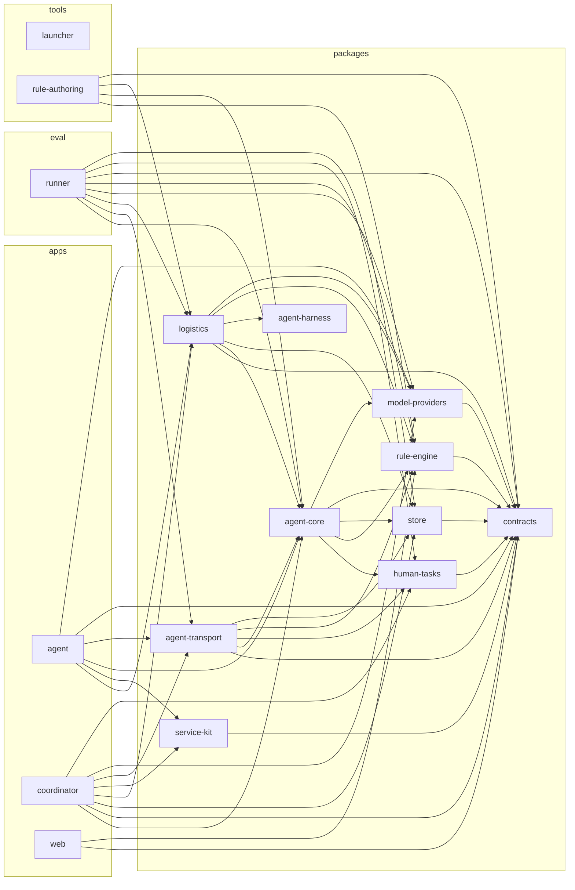

# Architecture graph

Generated by `pnpm architecture` from the import graph; `pnpm check` fails when it is out of
date. Each arrow is "depends on". Rules for which arrows are allowed live in
[.dependency-cruiser.cjs](../.dependency-cruiser.cjs).

