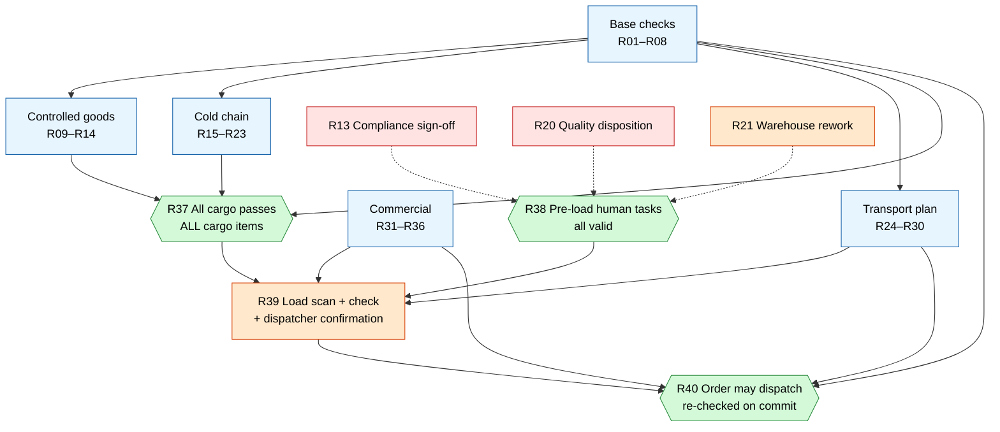
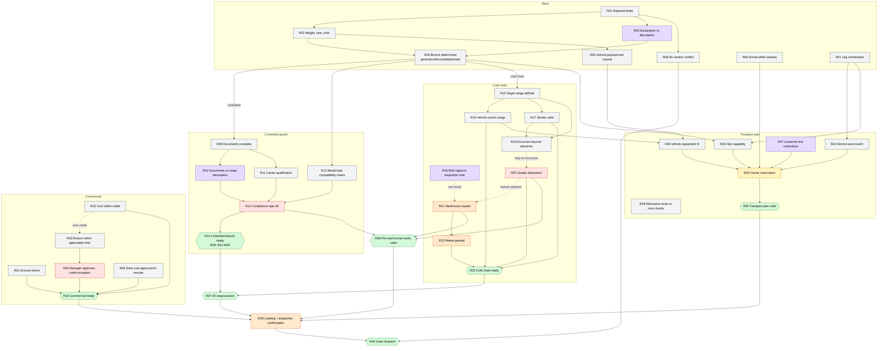
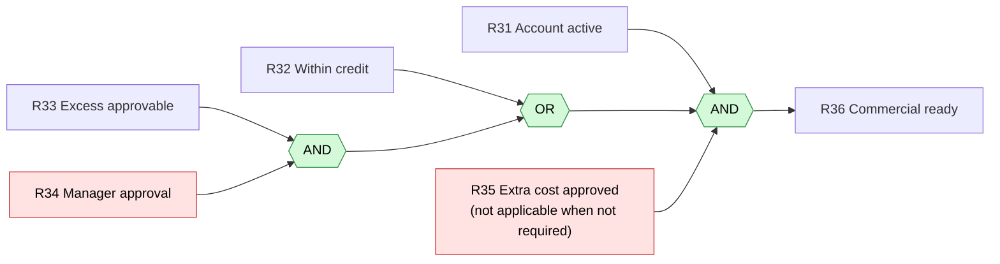
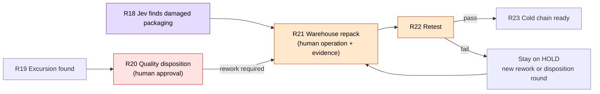

# Business rules map (R01–R40)

An arrow means "the source is a prerequisite of the target". A dashed arrow means "only triggered under a condition".

| Colour | Meaning |
|---|---|
| Grey | Code / decision table (deterministic) |
| Purple | Jev semantic judgement |
| Red | Human approval (a decision) |
| Orange | Human operation (field action + evidence) |
| Green | Combined gate (AND / OR / ALL) |
| Yellow | Simulated business write (reservation) |

## 1. Overview: five branches converge on dispatch release

## 2. Dependencies of all 40 rules

## 3. The two nested gates most likely to be bypassed

### Commercial: `R31 AND (R32 OR (R33 AND R34)) AND R35`

What to test: when over credit, a manager approval alone is not enough; R33 must also be within the approvable limit. While R33/R34 are pending (UNKNOWN), the OR must not turn into a pass.

### Cold chain rework chain: the order cannot be skipped

What to test: clicking "approve" cannot replace rework and retest; finishing rework only unlocks the retest, not dispatch; after the cargo is reworked again, the earlier quality approval is void (LOG-008).

## 4. Human involvement at a glance

| Rule | Type | Role | Bound to |
|---|---|---|---|
| R13 | Approval | Compliance reviewer | Cargo + carrier + route |
| R20 | Approval | Quality reviewer | Temperature record + packaging version |
| R34 | Approval | Commercial manager | Customer + quote version |
| R35 | Approval | Commercial manager | Quote difference |
| R21 | Operation | Warehouse operator | Rework round |
| R22 | Operation (capture) | Warehouse operator | Post-rework version |
| R39 | Operation + confirmation | Warehouse operator + dispatcher | Loading version |

Changing the vehicle or route invalidates R13, R16, R25, R29 and the related approvals; changing an unrelated contact does not.
