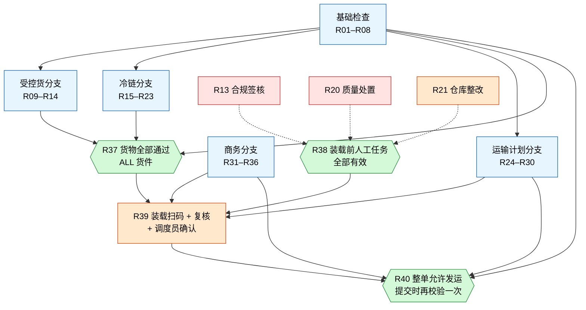
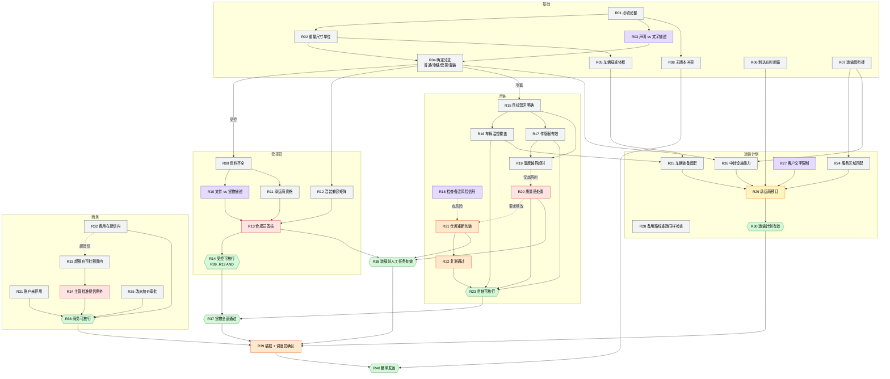
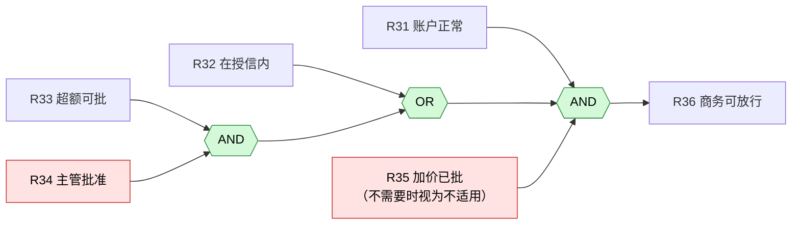
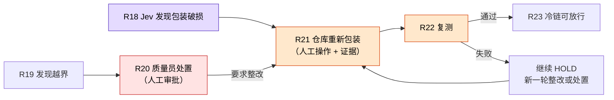

# 业务规则关系图（R01–R40）

箭头表示"前者是后者的前置"。虚线表示"只在某条件下才触发"。

| 颜色 | 含义 |
|---|---|
| 灰 | 代码 / 决策表（确定性） |
| 紫 | Jev 语义判断 |
| 红 | 人工审批（给出决定） |
| 橙 | 人工操作（现场动作 + 证据） |
| 绿 | 组合门槛（AND / OR / ALL） |
| 黄 | 模拟业务写入（预订） |

## 1. 全景：五个分支汇到整单放行

## 2. 全部 40 条规则的依赖

## 3. 两个最容易绕过的嵌套门槛

### 商务：`R31 AND (R32 OR (R33 AND R34)) AND R35`

要测的点：超授信时只有主管批准不够，还必须 R33 在可批额度内；R33/R34 在等待中（UNKNOWN）时 OR 不能借此变成通过。

### 冷链整改链：顺序不能跳

要测的点：点"批准"不能代替整改和复测；整改完成只解锁复测，不直接解锁发运；货物再次整改后，旧的质量批准作废（LOG-008）。

## 4. 人为参与一览

| 规则 | 类型 | 角色 | 绑定的版本 |
|---|---|---|---|
| R13 | 审批 | 合规审核员 | 货物 + 承运商 + 路线 |
| R20 | 审批 | 质量审核员 | 温控记录 + 包装版本 |
| R34 | 审批 | 商务主管 | 客户 + 报价版本 |
| R35 | 审批 | 商务主管 | 报价差额 |
| R21 | 操作 | 仓库操作员 | 整改轮次 |
| R22 | 操作（采集） | 仓库操作员 | 整改后版本 |
| R39 | 操作 + 确认 | 仓库操作员 + 调度员 | 装载版本 |

换车或换路线会让 R13、R16、R25、R29 以及相关审批失效；只改无关联系人不会。
